<h1 align="center">Hi there, I'm Hüseyin 👋</h1>

  

<h3 align="center">$ ls tools/</h3>

  
  
  
  
  
  
  
  
  
  
  
  
  

<h3 align="center">$ cat contact.txt</h3>

  <!-- TODO: Google Scholar, ORCID ve ResearchGate adreslerini doldur -->
  
  
  
  
  
  
  

